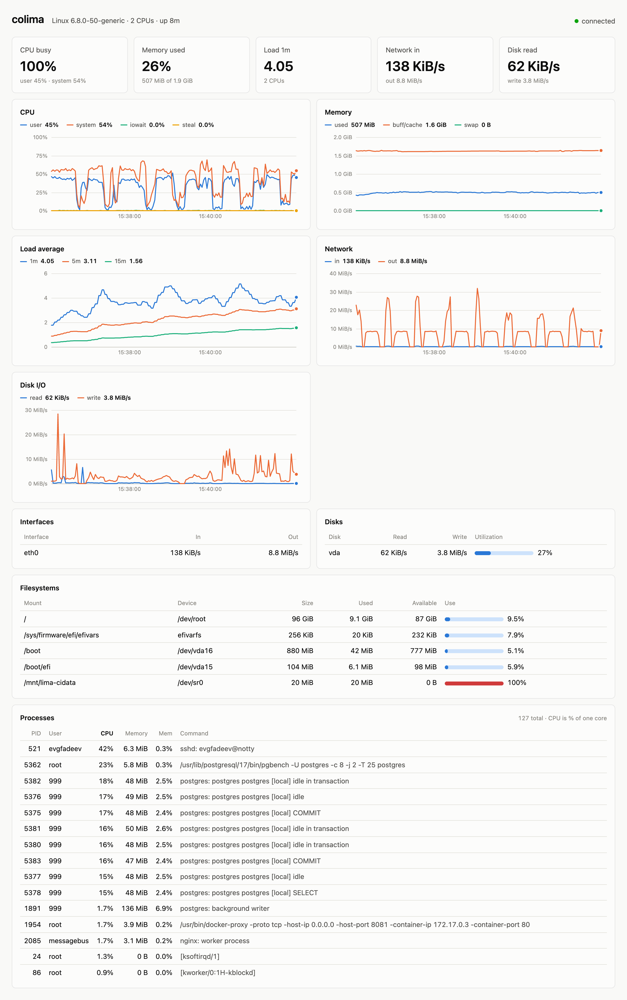

**English** | [Русский](README.ru.md)

# easydash

Live dashboard of a remote Linux host on localhost. Metrics are read over a single ssh
session from `/proc` and `df`; nothing is installed on the host.

<picture>
  <source media="(prefers-color-scheme: dark)" srcset="docs/screenshot-dark.png">
  
</picture>

Prebuilt binaries for Linux and macOS are on the [releases page](https://github.com/efadeev/easydash/releases). To build from source:

```sh
go build -o easydash .
./easydash [-port 8000] [-interval 2] user@host
```

The system `ssh` is used, so `~/.ssh/config`, agent and ProxyJump work as usual.
The last 30 minutes are kept in memory.
