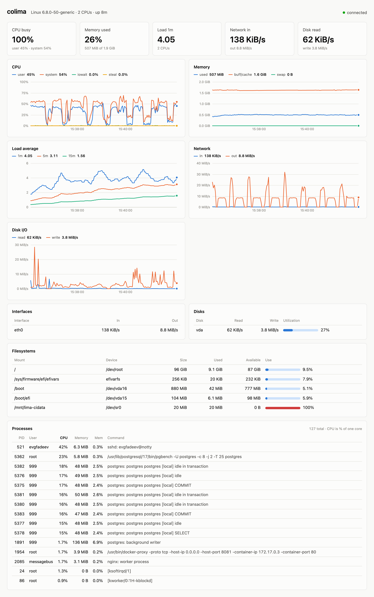

[English](README.md) | **Русский**

# easydash

Живой дашборд удалённого Linux-хоста на localhost. Метрики читаются из `/proc` и `df`
через одну ssh-сессию; на хост ничего не устанавливается.

<picture>
  <source media="(prefers-color-scheme: dark)" srcset="docs/screenshot-dark.png">
  
</picture>

Готовые бинарники для Linux и macOS — на [странице релизов](https://github.com/efadeev/easydash/releases). Сборка из исходников:

```sh
go build -o easydash .
./easydash [-port 8000] [-interval 2] user@host
```

Используется системный `ssh`, поэтому `~/.ssh/config`, агент и ProxyJump работают как обычно.
В памяти хранятся последние 30 минут.
